# Clip Notes

Take simple notes in your browser.

Clip Notes is a Manifest V3 Chrome extension that opens in the side panel. Notes stay on-device in `chrome.storage.local`, with pin, tags, search, drag-to-reorder, and JSON/CSV import & export.

**Name / copy options (for store listing later):**

| Option | One-liner |
| --- | --- |
| **Clip Notes** (current) | Take simple notes in your browser |
| Clip Notes | Capture and organize quick notes beside your tabs |
| Clip Notes | A lightweight side-panel notebook with tags and pinning |

Recommended for now: keep **Clip Notes** + *Take simple notes in your browser*.

## Features

- Side panel notebook (opens from the toolbar action)
- Create, edit, delete notes with a title and body
- Pin notes to a dedicated section (reorder within pinned / unpinned)
- Tags plus a single-select tag filter chip bar and debounced search
- Drag-and-drop reorder (disabled while a filter is active)
- Import / export as JSON or CSV
- Right-click **Save to Notes** on selected page text
- Light / dark via `color-scheme`

## Development setup

Requirements: Node.js 20+ recommended, and Google Chrome (or Chromium).

```bash
npm install
npm run build
```

### Load unpacked in Chrome

1. Run `npm run build` (or `npm run watch` while developing).
2. Open `chrome://extensions`.
3. Enable **Developer mode**.
4. Click **Load unpacked** and select this repository root (the folder that contains `manifest.json`).
5. Open the extension from the toolbar; it uses the side panel.

Reload the extension on the extensions page after rebuilding if the UI does not pick up changes.

### Scripts

| Command | Purpose |
| --- | --- |
| `npm run build` | Compile TypeScript to `dist/` |
| `npm run watch` | Rebuild on file changes |
| `npm run typecheck` | Typecheck without emitting |
| `npm run lint` | ESLint |
| `npm test` | Vitest unit tests |

## Permissions

| Permission | Why |
| --- | --- |
| `sidePanel` | Host the notes UI in Chrome’s side panel |
| `storage` | Persist notes locally (`local`) and pass clipped text (`session`) |
| `contextMenus` | “Save to Notes” on selected text |
| `downloads` | Save exported JSON/CSV files |

No remote servers are used for note storage.

## Import / export

Export produces notes in display order. Import **skips** ids that already exist.

### JSON

Array of note objects. Missing `pinned` → `false`. Missing `tags` → `[]`.

See [`examples/sample-notes.json`](examples/sample-notes.json).

### CSV

Header (current):

```text
id,title,content,createdAt,updatedAt,order,pinned,tags
```

- `tags` uses `;` between values (commas stay available inside CSV fields)
- Older exports without `order`, `pinned`, and/or `tags` still import

See [`examples/sample-notes.csv`](examples/sample-notes.csv).

### Try the sample data

1. Optionally export and back up your real notes first.
2. In Clip Notes, open **Import**.
3. Choose the JSON or CSV file under `examples/`.
4. Confirm the pinned notes, tag chips, and search/filter behavior.

To re-import the same samples after testing, delete those notes (or clear extension storage) first — duplicate ids are skipped.

## Project layout

```text
manifest.json          Extension manifest (MV3)
public/                Side panel HTML, CSS, assets, vendored SortableJS
src/                   TypeScript source
dist/                  Compiled JS (generated; run build)
examples/              Sample import files for demos and screenshots
reference/             Product screenshots for docs and store listing
```

## Screenshots

Assets live in [`reference/`](reference/). Populate the UI with [`examples/sample-notes.json`](examples/sample-notes.json) before capturing.

### Gallery

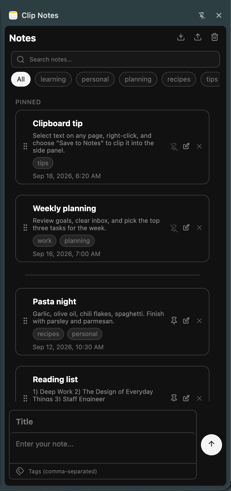

*Overview — pinned notes, tag chips, and search*

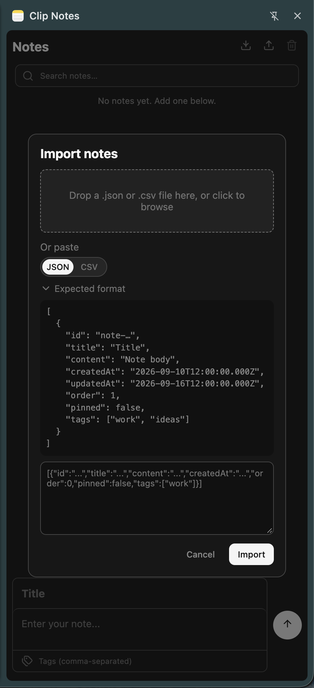

*Import notes from JSON or CSV*

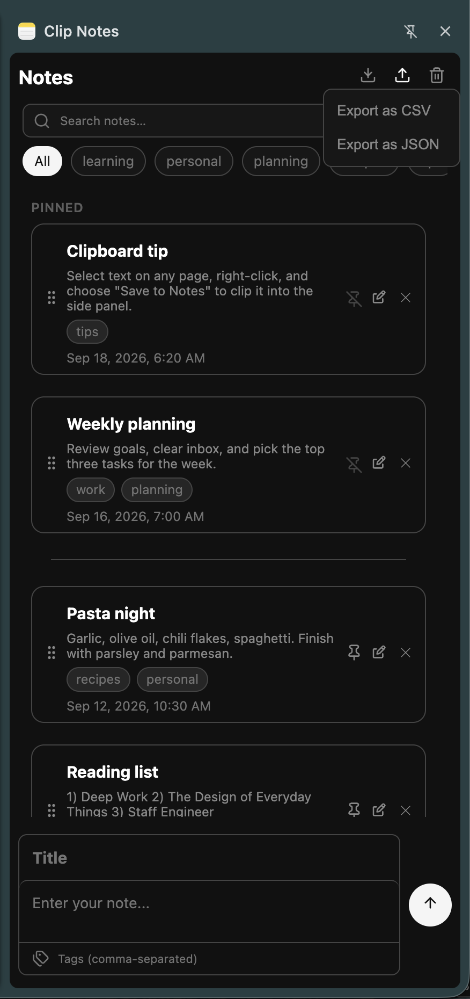

*Export as JSON or CSV*

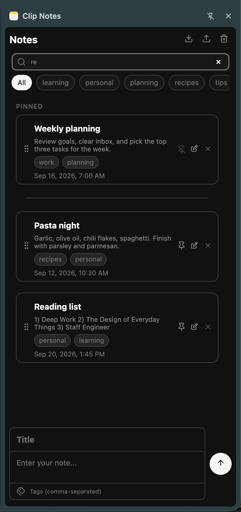

*Debounced search across title, body, and tags*

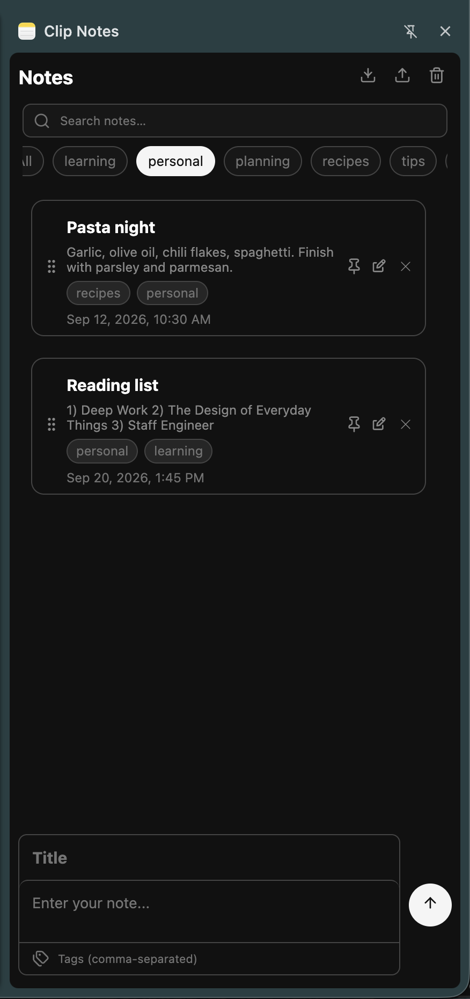

*Single-select tag filter chips*

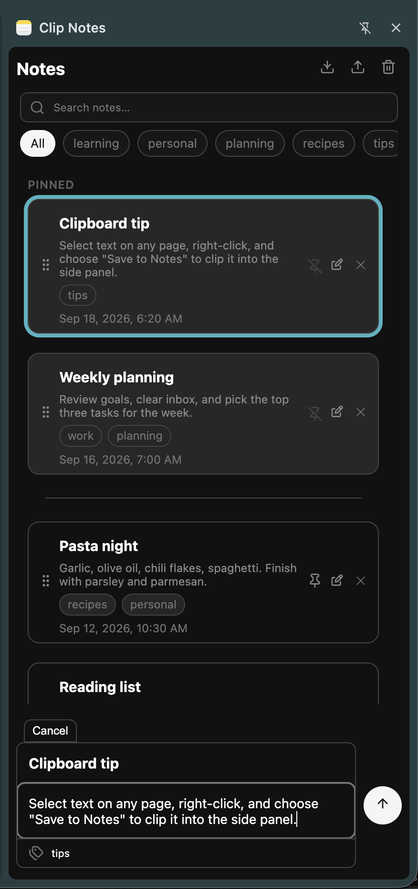

*Edit title, body, and tags*

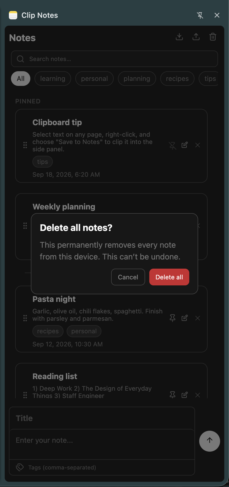

*Delete all notes (with confirmation)*

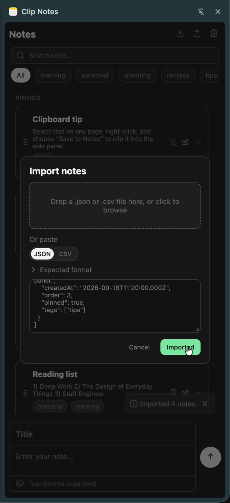

*Successful import*

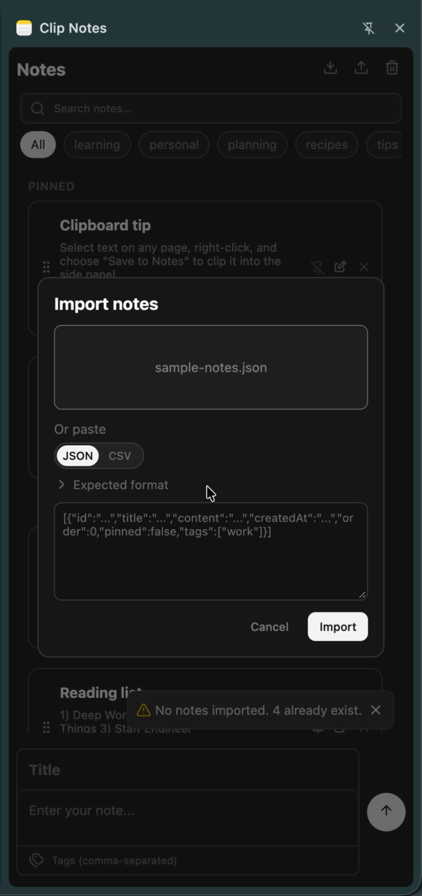

*Import skipped existing ids*

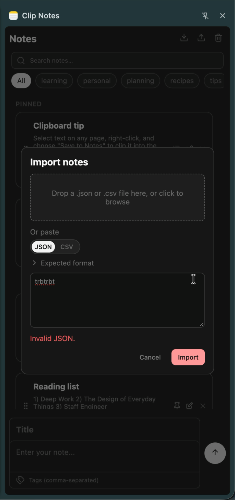

*Import validation error*

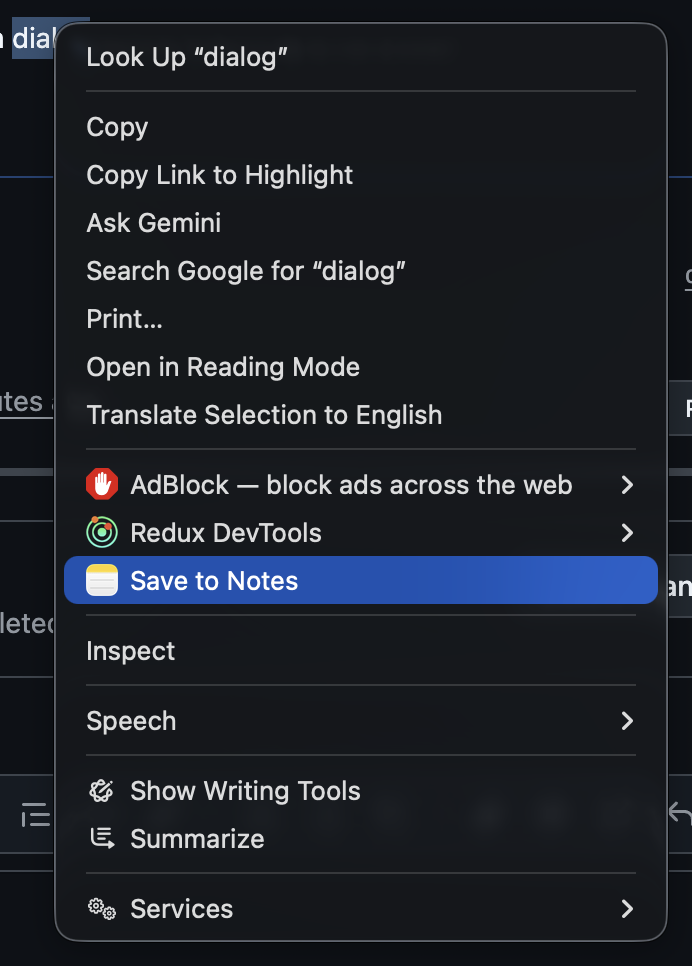

*Right-click selected text → Save to Notes*

### Chrome Web Store (pick 5)

The listing accepts up to **5** screenshots at **1280×800** or **640×400**.

These `reference/` files are tall side-panel captures (~876×1860), so they are great for the README but **won’t upload as-is** to the store. Before publishing, place each chosen shot on a 1280×800 (or 640×400) canvas (centered panel on a simple browser chrome / solid background).

Suggested store set:

1. `screenshot_0_base.png` — what the product is  
2. `screenshot_4_chip_filter.png` — tags / organization  
3. `screenshot_3_search_filter.png` — find notes quickly  
4. `screenshot_5_edit_note.png` — create / edit flow  
5. `screenshot_10_context_menu.png` — clip from the page  

Keep the rest for docs. Optional later: save store-sized exports under `reference/store/`.

## Author & license

- **Author:** Udochukwu Amaefule ([GitHub](https://github.com/UDsGitHub))
- **License:** [MIT](LICENSE)

MIT is a short permissive open-source license: others can use, modify, and redistribute the code (including in commercial products) as long as they keep the copyright notice. That is separate from Chrome Web Store distribution—you can still publish the extension on the marketplace while keeping the source MIT-licensed. A “commercial license” is only needed if you want to *sell or restrict* rights to the source itself; most indie extensions use MIT (or similar) for the repo.
